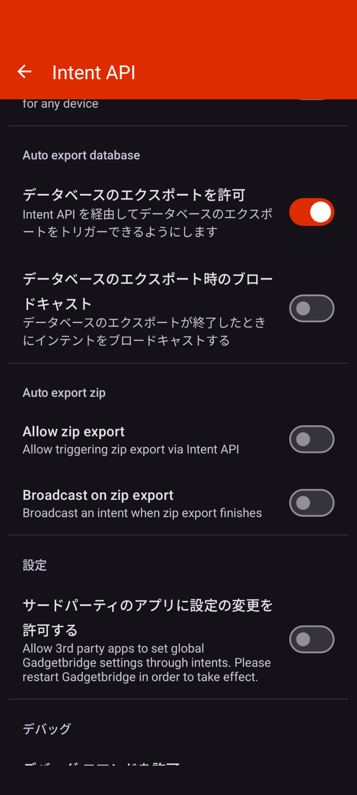
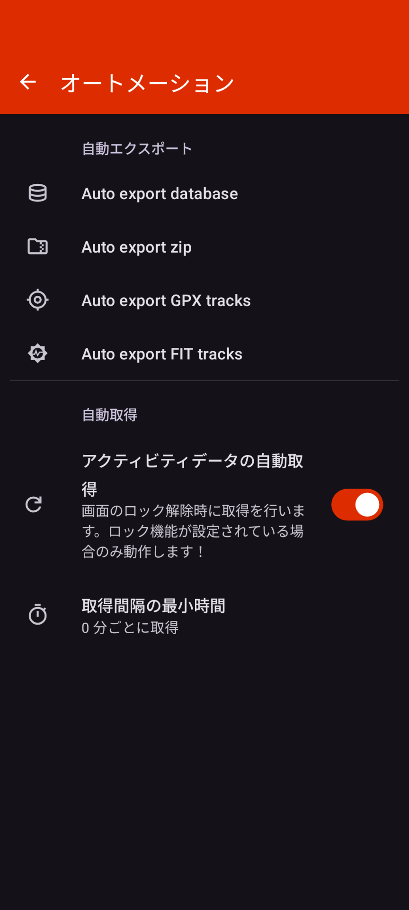
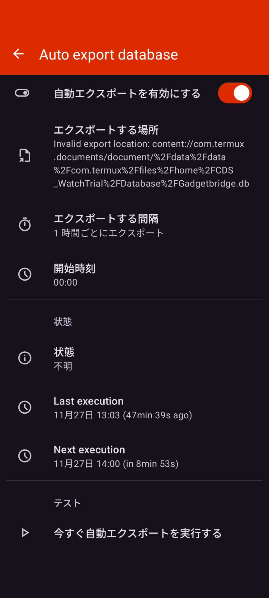
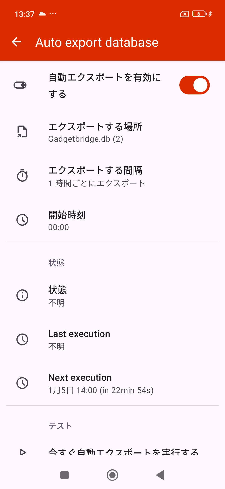
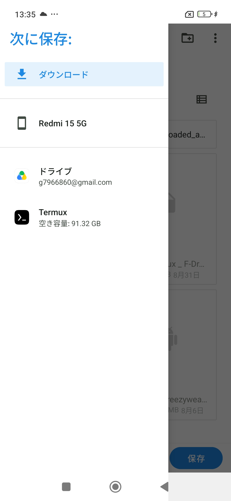
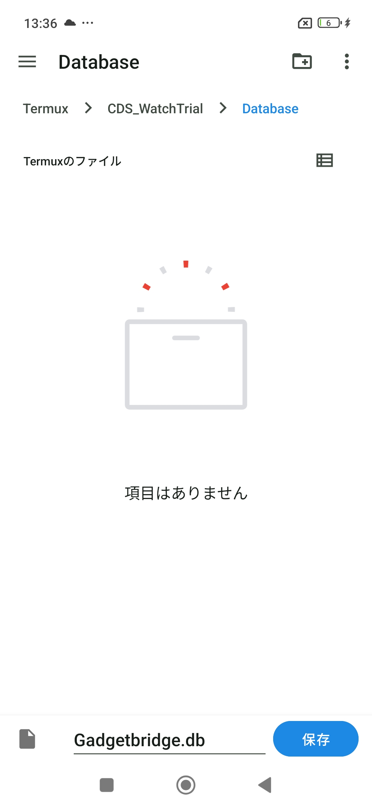
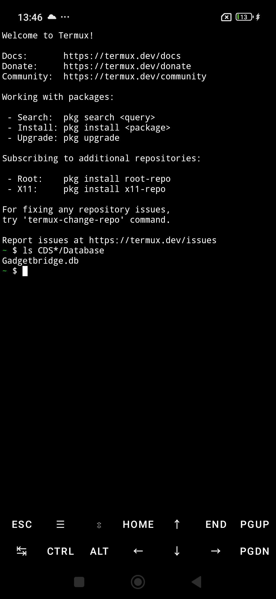

# スマートバンド測定データ取得手順書

Xiaomi Smart Band 10で取得した測定データを、GadgetbridgeとAndroidスマートフォンを介してRaspberry Piから読み出すための手順書です。

基本的なデータ取得を行うサンプルコードを用意しています。必要に応じて、取得データの処理や機能を追加してください。

## 前提

本手順書では、次の準備が完了しているものとします。

- Xiaomi Smart Band 10とGadgetbridgeの接続が完了している。
- AndroidスマートフォンにTermuxがインストールされ、Pythonを実行できる。
- Raspberry Piとスマートフォンが相互に通信できるネットワーク環境がある。

Smart BandとGadgetbridgeの接続方法については、[GadgetbridgeとSmart Bandデバイスの連携](../../docs/GadgetbridgeとSmartBandデバイスの連携/GadgetbridgeとSmartBandデバイスの連携.md)を参照してください。

Termuxのインストール、SSHによるスマートフォンの操作方法については、[遠隔バイブレーション手順書](../遠隔バイブレーション手順書/遠隔バイブレーション手順書.md)を参照してください。

## 確認事項

1. GadgetbridgeでSmart Bandの活動データが取得できていること。
2. Gadgetbridgeの`設定 → 開発者用設定 → Intent API`から、**データベースのエクスポートを許可**していること。



※ Gadgetbridgeの設定項目名はアプリのバージョンによって異なる場合があります。

## 手順

### 0. sqlite3のインストール

本システムでは、Gadgetbridgeが出力したSQLite形式のデータベースを利用します。

Pythonからデータベースを読み出すだけであれば標準ライブラリの`sqlite3`で対応できますが、データベースの内容を直接確認できるように、TermuxにSQLiteのコマンドラインツールをインストールしておくことを推奨します。

Termuxで以下のコマンドを実行してください。

```bash
pkg update
pkg install sqlite
```

インストール後、以下のコマンドで動作を確認します。

```bash
sqlite3 --version
```

バージョン情報が表示されればインストールは完了です。

また、後述する手順でGadgetbridgeからデータベースをエクスポートした後、次のようにデータベースを指定して、保存されているテーブルを確認できます。

```bash
sqlite3 -readonly ~/CDS_WatchTrial/Database/Gadgetbridge.db ".tables"
```

※ データベースのパスは、実際にエクスポートした場所に合わせて変更してください。

このツールを利用することで、Gadgetbridgeが記録したデータを確認したり、SQLを用いて必要な測定情報を調べたりできます。

### 1. Gadgetbridgeのデータ自動同期設定

Gadgetbridgeを起動し、`設定 → オートメーション`から、活動データを自動的に取得する設定を有効にします。

本開発の検証では、`アクティビティデータの自動取得`を有効にし、`取得間隔の最小時間`を0分として使用しました。

ただし、設定した間隔で心拍数などのすべての測定値が更新されるわけではありません。



### 2. データベースのエクスポート設定

Gadgetbridgeの`設定 → オートメーション → Auto export database`から、データベースのエクスポート先を設定します。

本システムでは、Gadgetbridgeの内部データを直接読み出さず、**エクスポートされたSQLiteファイル**をTermuxのPythonプログラムで読み出します。

エクスポート先はTermuxからアクセス可能な場所を指定してください。



<br>`自動エクスポートを有効にする`をONにし、`エクスポートする場所`を押す



<br>エクスプローラの表示がされる。タブを開いて`Termux`を選び、Termuxで扱えるディレクトリに格納する。
<br>`フォルダを作成`でディレクトリを構成し、（Termuxからあらかじめ`mkdir`で作るもOK）保存したいディレクトリでファイル名を指定して`保存`を押す。
(ファイル名はデフォルトの`Gadgetbridge.db`でよいかと)

 

<br>
エクスポート先の設定後、`今すぐ自動エクスポートを実行する`からエクスポートを実行し、ファイルが生成・更新されることを確認します。

Termux用ディレクトリは、Termux経由でしか確認できないので注意。`ls`コマンドを用いて確認してください。



なお、Gadgetbridgeの通常の手動エクスポートと、自動エクスポートの実行では、保存先の設定が異なる場合があります。本手順では自動エクスポート用の保存先を利用してください。

### 3. エクスポートしたデータベースの確認

エクスポートしたファイルがSQLiteデータベースとして読み出せることを確認します。

Termuxで、データベースを保存したディレクトリに移動し、以下のコマンドを実行してください。

```bash
sqlite3 -readonly Gadgetbridge.db
```

SQLiteが起動し、`sqlite>`と表示されます。

まず、データベース内に存在するテーブルの一覧を表示します。

```sql
.tables
```

Gadgetbridgeでは、測定データの種類や対応するデバイスごとに多数のテーブルが用意されています。

次に、Smart Band 10の活動データが格納される`XIAOMI_ACTIVITY_SAMPLE`について、レコード数を確認します。

```sql
SELECT COUNT(*) FROM XIAOMI_ACTIVITY_SAMPLE;
```

0より大きい数値が表示されれば、活動データが格納されていることを確認できます。

さらに、直近5件の歩数・心拍数の記録を確認してみます。

```sql
SELECT TIMESTAMP, STEPS, HEART_RATE
FROM XIAOMI_ACTIVITY_SAMPLE
ORDER BY TIMESTAMP DESC
LIMIT 5;
```

※ 心拍数等は、測定されていない場合に0などの無効値が格納されていることがあります。

確認が終わったら、以下のコマンドでSQLiteを終了します。

```sql
.quit
```

以上で、データベースのエクスポートおよび読み出しの確認は完了です。

SQLを利用することで、サンプルプログラムで対応していない測定項目についても、各自で調査・取得することが可能です。

### 4. 必要なPythonプログラムの準備

今回のサンプルプログラムは、以下のディレクトリにあります。

[`samples/get_data/`](../../samples/get_data/)

| ファイル名 | 用途 |
|---|---|
| [`database_reader.py`](../../samples/get_data/database_reader.py) | SQLiteデータベースから測定値を読み出す |
| [`smartphone_server.py`](../../samples/get_data/smartphone_server.py) | HTTPリクエストに応じて測定データを返す |
| [`samplecode4raspberrypi.py`](../../samples/get_data/samplecode4raspberrypi.py) | Raspberry PiからHTTPリクエストを送る |

[`database_reader.py`](../../samples/get_data/database_reader.py)および[`smartphone_server.py`](../../samples/get_data/smartphone_server.py)をTermux上に用意します。

[遠隔バイブレーション手順書](../遠隔バイブレーション手順書/遠隔バイブレーション手順書.md)と同様に、nano等のエディタを使用してコードをコピーするなど、各自の作業環境に応じた方法でファイルを作成してください。

なお、[`database_reader.py`](../../samples/get_data/database_reader.py)および[`smartphone_server.py`](../../samples/get_data/smartphone_server.py)は同一のディレクトリに配置してください。

次に、[`smartphone_server.py`](../../samples/get_data/smartphone_server.py)の`DB_PATH`を、実際にエクスポートしたデータベースの保存場所に合わせて変更します。

[`samplecode4raspberrypi.py`](../../samples/get_data/samplecode4raspberrypi.py)については、Raspberry Pi側に用意してください。

### 5. スマートフォン側でHTTPサーバーを起動する

Termuxでサーバーのファイルがある場所へ移動します。

```bash
cd ~/{自身で設定したディレクトリ}
```

次のコマンドでサーバーを起動します。

```bash
python smartphone_server.py
```

正常に起動すると、例えば以下が表示されます。

```text
Listening on 0.0.0.0:8081
Auto-export interval: 5 min
```

サンプルではポート番号8081を使用します。遠隔バイブレーション用のサーバー（8080）とは異なるポートです。

また、サーバー起動中は、5分間隔でGadgetbridgeへDBエクスポート要求を送信します。この間隔は`AUTO_EXPORT_INTERVAL_MIN`で変更可能です。

サーバーを終了する場合は`Ctrl+C`を押してください。

### 6. Raspberry Piから測定データを取得する

Raspberry Pi側ではPythonの`requests`ライブラリを使用します。インストールされていない場合は、使用するPython環境にインストールしてください。

```bash
python -m pip install requests
```

サンプルコードの`PHONE_URL`を、スマートフォンの実際のIPアドレスに合わせて変更します。

```python
PHONE_URL = "http://スマートフォンのIPアドレス:8081"
```

例えば、最新の測定データを取得するには次のようにします。

```python
import requests

response = requests.get(
    f"{PHONE_URL}/data/latest",
    timeout=10
)
response.raise_for_status()

latest = response.json()
print(latest)
```

サーバーが正常に動作していれば、測定値をPythonの辞書形式で取得できます。

### 7. データベースの更新状況を確認する

エクスポートされたDBファイルの更新状況は、次のURLで取得できます。

```python
response = requests.get(
    f"{PHONE_URL}/data/status",
    timeout=10
)
print(response.json())
```

`database_file_modified_at`はDBファイルの最終更新時刻（Unix秒）、`database_file_age_seconds`は更新からの経過秒数です。

また、次のURLへアクセスすると、Gadgetbridgeへ任意のタイミングでDBエクスポートを要求できます。

```python
response = requests.get(
    f"{PHONE_URL}/data/export",
    timeout=10
)
print(response.json())
```

正常に要求を送信できた場合、HTTP 202と次のJSONが返ります。

```json
{
  "export_request": "sent"
}
```

ただし、これは**エクスポート要求の送信が完了したことを示すものであり、DBの更新完了を保証するものではありません。**

## 利用できるデータ

サンプルのHTTPサーバーでは、以下のエンドポイントを使用できます。

| エンドポイント | 内容 |
|---|---|
| `GET /data/latest` | 各測定項目の最新値 |
| `GET /data/daily` | DB内の最新日の日次集計・睡眠情報 |
| `GET /data/daily?day=YYYY-MM-DD` | 指定日の集計データ |
| `GET /data/status` | エクスポート済みDBの更新状況 |
| `GET /data/export` | DBエクスポートの要求 |

### 最新データ

`/data/latest`では、歩数・心拍数・ストレス・SpO₂・バッテリー残量を取得できます。

`measured_at`には各項目の記録時刻、`age_seconds`には記録からの経過時間が格納されます。

測定項目によって更新間隔が異なるため、これらの値を参照してデータの新しさを確認してください。

### 日次集計・睡眠データ

`/data/daily`では、日次歩数、消費カロリー、心拍数の集計値、睡眠時間などを取得できます。

睡眠情報は`sleep`内に格納されます。睡眠セッションは**起床日を基準**として集計し、同日に複数のセッションが存在する場合はリストとして返します。

測定データが存在しない項目には`null`が返される場合があります。PythonでJSONを読み込んだ場合は`None`に対応します。

## ソースコード

- スマートフォンサーバ：[smartphone_server.py](../../samples/get_data/smartphone_server.py)
- データベース読み出し：[database_reader.py](../../samples/get_data/database_reader.py)
- Raspberry Pi側サンプル：[samplecode4raspberrypi.py](../../samples/get_data/samplecode4raspberrypi.py)

それぞれのプログラムを改造することで、データの加工や追加の測定項目の取得などに応用できます。

## 注意事項

### 測定データの鮮度

本システムでは、次の3つの処理が独立しています。

1. Smart BandからGadgetbridgeへの測定データの同期
2. GadgetbridgeからSQLiteファイルへのエクスポート
3. SQLiteファイルからRaspberry Piへのデータ送信

DBファイルが更新されていても、Smart Bandの最新データが同期されているとは限りません。

特に、心拍数やSpO₂などの測定間隔は一定とは限らないため、リアルタイム性が要求される用途では注意が必要です。

### セキュリティ

サンプルのHTTPサーバーには認証機能がありません。

測定データには個人の生体情報が含まれるため、第三者がアクセスできるネットワーク上では、そのまま運用しないでください。

実際に使用する場合は、ネットワークのアクセス制限やHTTP APIの認証・通信保護を検討してください。

また、実際の測定データを含むSQLiteファイルやデバイスのIPアドレスをGitHub等へアップロードしないでください。<!-- 2敗 -->

### 動作しない場合

HTTP通信ができない場合は、スマートフォンとRaspberry Piが相互に通信できること、IPアドレスとポート番号が正しいことを確認してください。

DBが更新されない場合は、GadgetbridgeのIntent API許可設定、自動エクスポート先、Termux側のサーバーログを確認してください。

## 他

httpのurlを通じてrequestを送信するという、[`vibration`](../../samples/vibration/)にかなり寄せた仕様での実装をしました。
両者サーバの統合も可能であると考えます。

他にもいくらでも工夫の余地があるので、頑張って工夫してみてください。

---

**Author: [Chi-robot](https://github.com/G-uruCPQ/)** | Date: 2026-11-20